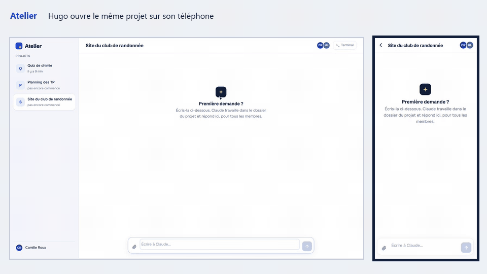
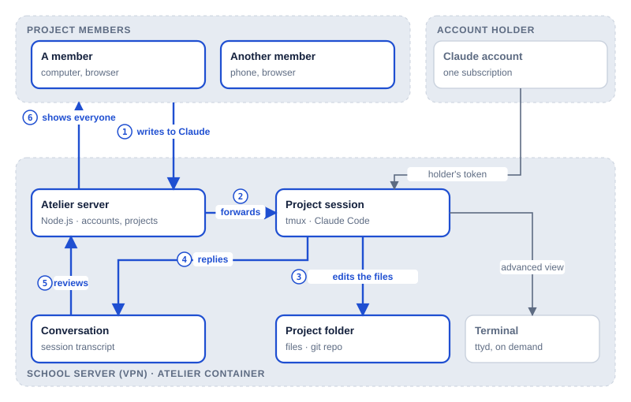

[English](README.md) · **Français**

# Atelier

**Un seul compte Claude fait tourner les sessions de toute une équipe.** Chaque projet est une session Claude Code dans le navigateur, partagée par ses membres, qui n'ont pas besoin de compte Claude.

*Deux membres, l'un sur ordinateur, l'autre sur téléphone, dans la même session. [Vidéo complète (1 min 12)](https://drive.google.com/file/d/1izOPSN_ErBeVkxRjEOXjuPUVodxSp9to/view)*

## Utilisation

- **Session partagée.** Tous les membres d'un projet ouvrent la même session et le même dossier de travail. Le compte Claude du titulaire la fait tourner.
- **Vue conversation.** Chaque message affiche le nom et l'avatar de son auteur. Les réponses de Claude sont mises en forme. Ses actions se replient en une ligne (`2 actions · index.html`) qui se déplie d'un clic. *Claude travaille · modifie index.html* s'affiche en direct chez tous les membres.
- **Terminal.** Derrière le bouton `>_` sur ordinateur ; absent sur téléphone.
- **Accueil.** Cartes des membres et de l'activité ; projets triés par activité. Un membre qui n'a qu'un projet arrive directement dedans.
- **Console d'administration.** Comptes, membres, et projets rangés par glisser-déposer.

## Architecture

## Fonctionnement

| | Novembre 2026 |
|---|---|
| **Hébergement** | Serveur de l'école, accessible seulement par le VPN de l'école |
| **Horaires** | Arrêt chaque jour à 20 h (Paris), conversations gardées ; réouverture sur demande |
| **Pile** | Docker, Node.js, `tmux`, `ttyd` |

---

**Anthony Hunt** · [ingevision.cloud](https://ingevision.cloud/?p=atelier) · [LinkedIn](https://www.linkedin.com/in/anthony-hunt-3948a9196) · [GitHub](https://github.com/anthohunt)
Le code et les projets de l'équipe sont privés ; ce dépôt ne contient que cette page.
