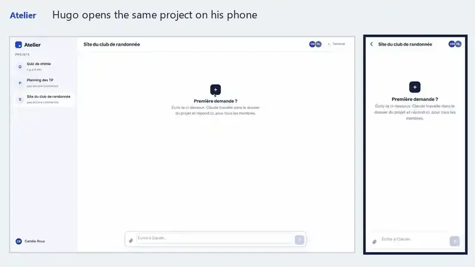
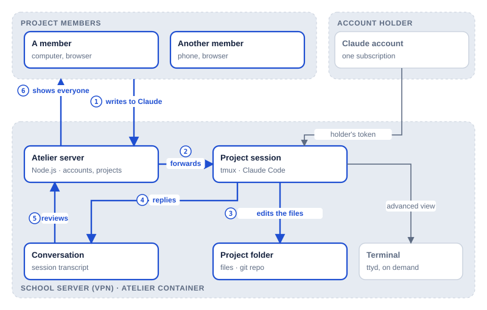

**English** · [Français](README.fr.md)

# Atelier

**One Claude account runs a whole team's sessions.** Each project is a Claude Code session in the browser, shared by its members, who need no Claude account of their own.

*Two members, one on a computer, one on a phone, in the same session.*

## Using it

- **Shared session.** Every member of a project opens the same session and working folder.
- **Conversation view.** Each message shows its author's name and avatar. Claude's replies are formatted. Its actions fold into one line (`2 actions · index.html`) that expands on click. *Claude is working · editing index.html* appears live for every member.
- **Terminal.** Behind the `>_` button on a computer; not offered on a phone.
- **Home.** Cards for members and activity; projects sorted by activity. A member with a single project lands directly in it.
- **Admin console.** Manages accounts and members; projects are arranged by drag and drop.

## Architecture

*Diagram labels are in French.*

## Deployment

- **Hosting.** School server, reachable only through the school VPN.
- **Hours.** Stops daily at 20:00 Paris time, conversations kept; reopens on request.
- **Stack.** Docker, Node.js, `tmux`, `ttyd`.

---

**Anthony Hunt** · [ingevision.cloud](https://ingevision.cloud/?lang=en&p=atelier) · [LinkedIn](https://www.linkedin.com/in/anthony-hunt-3948a9196) · [GitHub](https://github.com/anthohunt)

The code and the team's projects are private.
